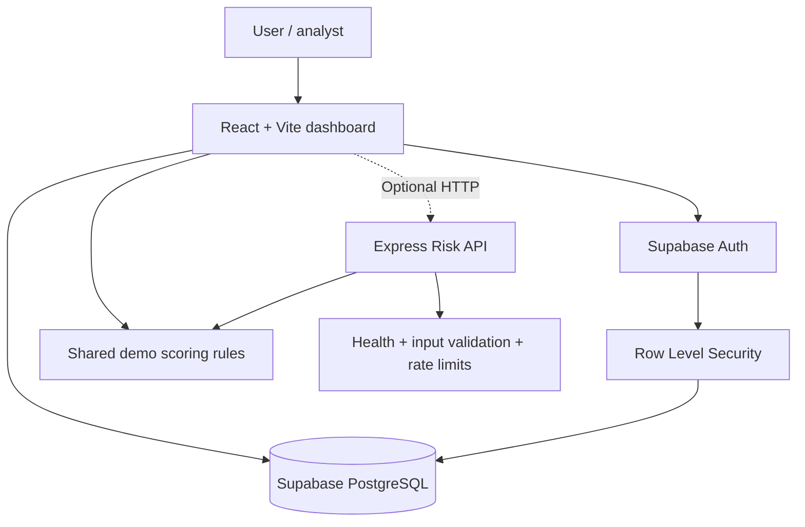

<div align="center">

# 🛡️ FraudShield AI

### Explainable fraud-risk monitoring for synthetic financial transactions

**Detect unusual patterns · Review flagged activity · Understand every risk signal**

[](https://github.com/patilchannabasava43-pixel/FraudShield/actions/workflows/ci.yml)
[](frontend/)
[](docs/DATABASE.md)
[](backend/)
[](docs/SECURITY.md)

</div>

---

## Overview

FraudShield AI is an **academic full-stack fraud-risk exploration project**. The React dashboard visualizes sample financial transactions, flags anomalies, and explains why a transaction receives a particular risk score. Supabase provides email/password accounts and private storage for demo transactions and configurable risk thresholds. An optional Express API exposes the same **transparent rules-based scoring engine** for integration and future deployment.

> **Accuracy note:** Despite the project name, this version is **not a trained machine-learning fraud detector**. Its 5–98 scores are heuristic teaching aids, **not calibrated probabilities**. It does not access bank accounts, move money, block payments, or make lending/credit decisions.

## What you can do

| Feature | Functionality | Data source |
| --- | --- | --- |
| **Overview** | Transaction totals, monitored volume, weekly activity, urgent alerts | Synthetic transactions |
| **Transactions** | Search, inspect, filter, and export transaction CSV | Browser or Supabase |
| **Fraud alerts** | Review high/medium-risk signals; mark genuine/fraud | Browser or Supabase |
| **Analytics** | Spending categories, trend charts, risk composition | Synthetic transactions |
| **Detection rules** | Adjust amount, velocity, score thresholds and signal toggles | Browser or Supabase |
| **Simulation** | Generate normal, international, rapid-transfer and high-value examples | Generated synthetic data |
| **Authentication** | Single email/password form; sign-in or instant demo account creation when confirmation is disabled | Supabase Auth |
| **Risk API (optional)** | Validate and score demo transactions over HTTP | Express + shared rule engine |

## Technology stack

| Layer | Technology |
| --- | --- |
| Frontend | React 18, Vite 6, JavaScript, Recharts, Lucide icons, custom responsive CSS |
| API | Node.js 22+, Express, CORS, request validation, rate limiting |
| Data & identity | Supabase Auth + PostgreSQL, Row Level Security |
| Shared logic | Pure JavaScript scoring library used by the React app and API |
| Testing | Node.js built-in test runner, GitHub Actions |
| Deployment | Render live frontend and Express API |

## Architecture



**The frontend works without the API.** The optional API is used when `VITE_API_URL` is configured; it does not handle bank credentials or store financial records. Supabase is the source of truth for signed-in user data. See [Architecture](docs/ARCHITECTURE.md).

## Repository layout

```text
FraudShield/
├── frontend/
│   ├── src/
│   │   ├── api/                 # Optional risk API client
│   │   ├── components/          # Navigation, tables, charts, dialogs, UI
│   │   ├── config/              # Navigation & UI constants
│   │   ├── data/                # Synthetic transaction generators
│   │   ├── lib/                 # Supabase client & workspace persistence
│   │   ├── pages/               # Overview, Transactions, Alerts, Analytics, Rules, Settings
│   │   ├── styles/              # Responsive design system
│   │   ├── App.jsx              # Session, state, routing and orchestration
│   │   └── AuthScreen.jsx       # Register and login
│   ├── package.json
│   └── vite.config.js
├── backend/
│   ├── src/app.js              # Express app & routes
│   ├── src/server.js           # API entry point
│   ├── src/validators.js       # Validates demo payloads & thresholds
│   ├── test/                   # Backend unit tests
│   └── package.json
├── shared/risk.js              # One source of truth for risk rules
├── supabase/schema.sql        # RLS-protected PostgreSQL schema
├── tests/                     # Shared risk-engine tests
├── docs/                      # Architecture, API, DB, security, deployment, roadmap
├── .github/workflows/ci.yml  # Test & build checks
├── render.yaml                # Optional Phase 3 deployment plan
└── package.json               # Root scripts
```

## Quick start — Windows, macOS, Linux

**Prerequisites:** Node.js **22+**, npm, Git.

```bash
# 1. Get the source
git clone https://github.com/patilchannabasava43-pixel/FraudShield.git
cd FraudShield

# 2. Install the frontend
npm --prefix frontend install

# 3. Start the web dashboard
npm run dev
```

Open **http://localhost:5173**. Enter your email and password on the single sign-in screen. Existing accounts sign in; new demo accounts are automatically created. **For instant registration without verification emails, disable Supabase Authentication → Sign In / Providers → Email → Confirm email in the project dashboard.** The React client cannot override that server setting.

**Optional API** (new terminal):

```bash
npm --prefix backend install
npm run dev:api
```

To make simulations use the API, create `frontend/.env.local`:

```env
VITE_API_URL=/api
```

Vite proxies `/api` to `http://127.0.0.1:5000`. Without this option, scoring stays in the browser and the dashboard still works.

### Supabase configuration

A dedicated Supabase project already exists: **FraudShield** in Mumbai (`lgpnfcocmfnhnsgeqbbu`). The client uses the **public** project URL and publishable key. You can also override both with `frontend/.env.local`:

```env
VITE_SUPABASE_URL=https://lgpnfcocmfnhnsgeqbbu.supabase.co
VITE_SUPABASE_PUBLISHABLE_KEY=<your-browser-safe-publishable-key>
```

Never commit the **secret** or `service_role` key. For this demo, set **Authentication → Sign In / Providers → Email → Confirm email** to OFF if you want password-only registration. This means users can register using email addresses they do not control: avoid this configuration for real customer/financial data. In **Authentication → URL Configuration**, use the deployed site `https://fraudshield-web-cyi6.onrender.com` and keep `http://localhost:5173` as a development redirect if needed. See [Database & Auth](docs/DATABASE.md).

## How scoring works

Each synthetic record starts at **7 points**. Signals add heuristic points (for example: high amount +28, international activity +22, unrecognized device +19, rapid transaction velocity +22). The final score is clipped to **5–98** and classified based on configurable thresholds.

- **Low:** Below the medium-risk threshold (default 40)
- **Medium:** At least 40, below the high-risk threshold (default 70)
- **High:** At least 70

The application displays the contributing factors, not a black-box claim. **These scores are not validated against real fraudulent transactions.** See [Architecture](docs/ARCHITECTURE.md).

## Testing

```bash
npm test                 # Unit tests for engine and API validation
npm run build            # Vite production build (after frontend npm install)
npm run test:api         # HTTP API tests (install backend dependencies first)
npm run check            # Unit tests + API tests + frontend build
```

GitHub Actions also installs dependencies and runs the test/build workflow on pushes and pull requests. See [Testing](docs/TESTING.md).

## API endpoints (optional)

| Method | Endpoint | Purpose |
| --- | --- | --- |
| `GET` | `/api/health` | Service status |
| `GET` | `/api/risk/rules` | Return demo defaults |
| `POST` | `/api/risk/analyze` | Score one synthetic transaction |
| `POST` | `/api/risk/batch` | Score 1–100 synthetic transactions |

See request/response examples in [API Reference](docs/API_REFERENCE.md).

## Project status

- **Phase 1:** Responsive browser demo, dashboard, charts, alerts — complete.
- **Phase 2:** Supabase project, Auth, database tables, per-user RLS, persistence — configured; user flows still require browser acceptance testing.
- **Phase 2.5:** Modular monorepo, optional Express scoring API, test suite, documentation — included.
- **Phase 3:** Render frontend `https://fraudshield-web-cyi6.onrender.com` and API `https://fraudshield-api-hlhm.onrender.com` — deployed. A blueprint is in `render.yaml`.

Review the [roadmap](docs/ROADMAP.md), [security notes](docs/SECURITY.md), [deployment guide](docs/DEPLOYMENT.md), and [contributing guide](CONTRIBUTING.md).

---

<div align="center"><b>FraudShield AI</b> — A transparent, safety-conscious engineering demonstration. Built for learning, not real payment decisions.</div>