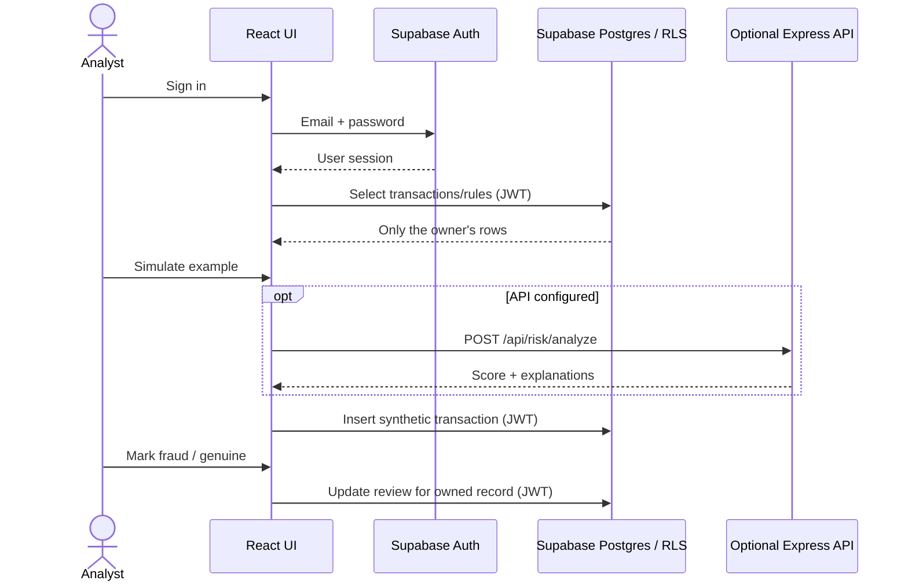

# System architecture

## Purpose and boundaries

FraudShield AI is a demonstrator. It intentionally has three independently usable layers: a React app for visualization, Supabase for authentication and persistence, and an optional Express scoring API. This design makes it possible to test the dashboard before deploying a backend, but prevents the README from implying a real banking integration.

## Layer responsibilities

| Layer | Path | Responsibility |
| --- | --- | --- |
| Presentation | `frontend/src/pages/`, `frontend/src/components/` | Dashboard views, charts, navigation, inspector UI |
| State orchestration | `frontend/src/App.jsx` | Session, filtering, transaction simulation, alerts, UI state |
| Supabase integration | `frontend/src/lib/supabase.js`, `workspace.js` | Auth, private per-user queries, transaction/review persistence |
| Synthetic fixtures | `frontend/src/data/transactions.js` | Seeded sample financial records and preset scenarios |
| Rules engine | `shared/risk.js` | Deterministic score, risk level, explanation factors |
| Optional API | `backend/src/` | Request validation, health, scoring endpoints, rate limiting |
| Database | `supabase/schema.sql` | Tables, constraints, owner-only RLS policies |

## Application flow

1. React initializes the Supabase browser client using the **publishable** API key.
2. The user registers or signs in via Supabase Auth; sessions are managed by Supabase.
3. `loadWorkspace(user.id)` retrieves that user's transaction rows and rule settings. On a first login, synthetic sample records are inserted (there is no real bank integration).
4. The shared risk engine calculates a score and an array of contributing signals. Dashboard charts and alert filters render from that score.
5. An analyst can mark a record genuine or fraudulent, or adjust rule settings; those writes go to the owner-scoped Supabase tables.
6. If `VITE_API_URL` is set, a simulated transaction can be scored by the optional Express API. Otherwise the exact same rules run directly in the browser. **Review decisions and user data always use Supabase, not the Express API.**

## Risk scoring is a heuristic

`analyzeTransaction()` initializes a score of 7 and applies additive rule weights, clipping the total to 5–98. Defaults: medium threshold 40, high threshold 70. Risk signals include amount threshold, multiple-of-threshold, international flag, unfamiliar device, transaction velocity, unusual hour and merchant flag. It always emits human-readable reasons. The rules use **input flags**, not learned transaction history or ground-truth labels; do not label the output as a model prediction or probability.

## Limitations and future improvements

- The Supabase browser client performs user-authorized writes directly with Row Level Security; there is no service-role key in frontend code.
- A dedicated server-side policy engine and independently computed risk decisions would be required before any real financial use.
- No real-time banking connectors, payment blocking, or bank account access exist.
- `VITE_API_URL` enables optional risk scoring, not a database API.
- Auth refresh/sign-in, RLS and deployment should be smoke-tested in a real browser before launch.